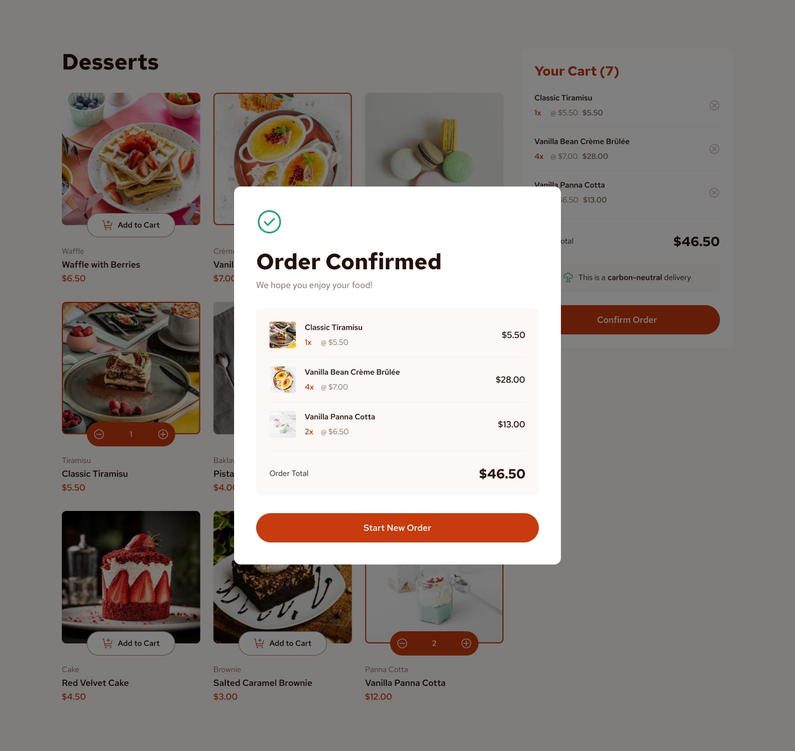
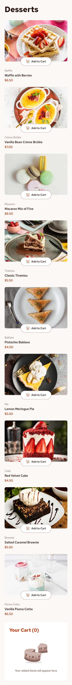

# Dessert Shop

A responsive dessert menu with an interactive shopping cart. Browse the desserts, adjust quantities, review your order, and confirm it in a summary dialog.

## Designs

### Desktop



### Mobile



## Get started

### Requirements

- Node.js (a current LTS release)
- pnpm

### Install and run

```bash
pnpm install
pnpm dev
```

Open the local URL printed in the terminal by Vite.

## Try the app

- [ ] Select **Add to Cart** on a dessert.
- [ ] Use the `+` and `−` controls to change its quantity.
- [ ] Check that the cart count and subtotal update.
- [ ] Remove a dessert with the remove button in the cart.
- [ ] Select **Confirm Order** to open the order summary.
- [ ] Select **Start New Order** to clear the cart and begin again.
- [ ] Resize the browser to see the layout adapt to mobile and desktop.

<details>
<summary>How cart totals are calculated</summary>

Each selected dessert appears in the cart with its quantity, unit price, and line subtotal. The order total is the sum of all line subtotals.

The current cart is held in app state. It is cleared when **Start New Order** is selected and is not saved after refreshing the page.

</details>

## Useful commands

| Command        | What it does                             |
| -------------- | ---------------------------------------- |
| `pnpm dev`     | Start the local development server       |
| `pnpm build`   | Type-check and create a production build |
| `pnpm lint`    | Run ESLint                               |
| `pnpm preview` | Preview the production build locally     |

## Built with

- React
- TypeScript
- Vite
- Tailwind CSS

## Project layout

```text
src/
├── components/
│   ├── Add_tocart_component.tsx
│   ├── Product_list_component.tsx
│   ├── Your_cart_component.tsx
│   └── order_confirmed_component.tsx
├── assets/
└── info.tsx
```

Product names, prices, and image references are defined in `src/info.tsx`. The shared cart state is managed in `src/App.tsx` and passed to the product list, cart, and order confirmation dialog.

## Making changes

1. Update product data in `src/info.tsx`.
2. Change cart controls or the product-card layout in `src/components/`.
3. Run `pnpm build` and `pnpm lint` before sharing your changes.
